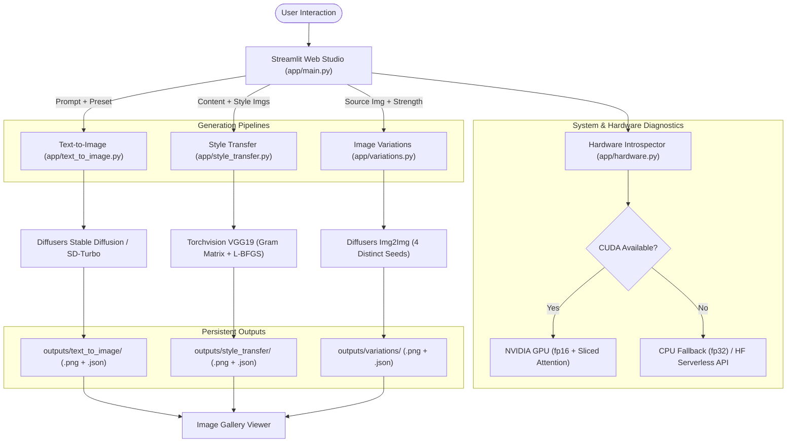
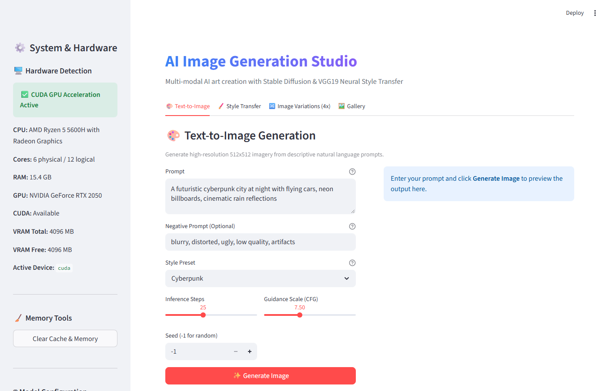
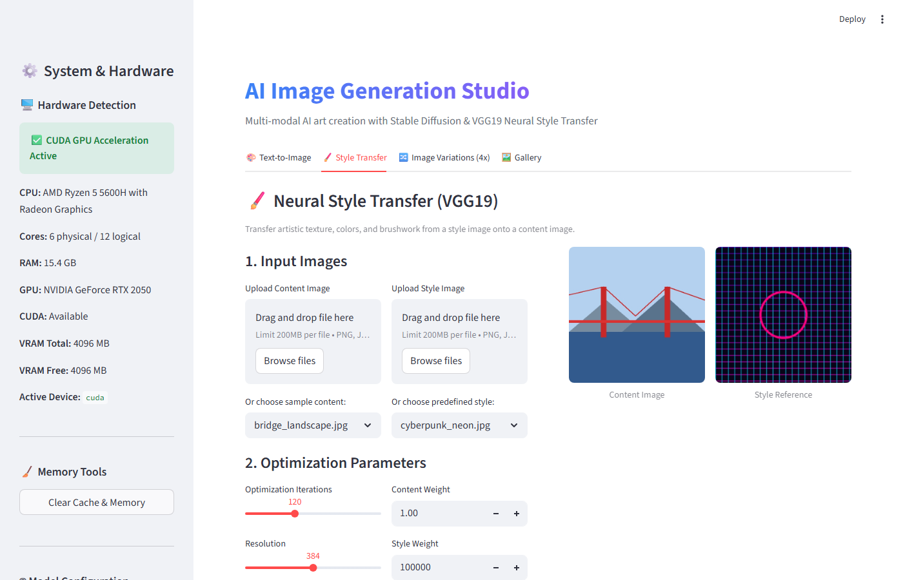
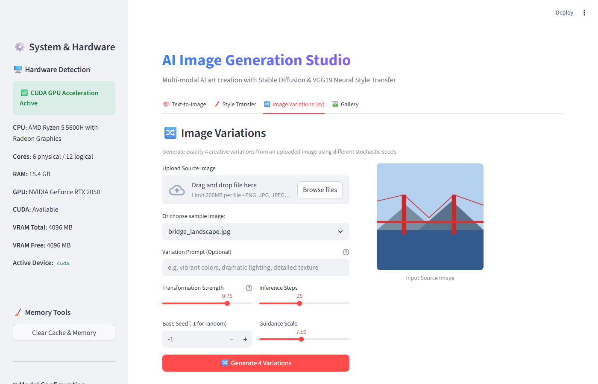
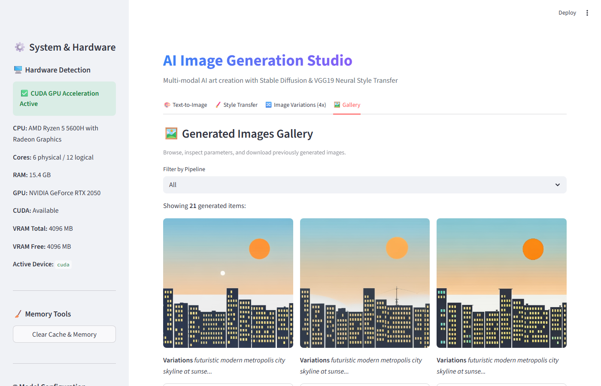

# AI Image Generation Studio 🎨

[](https://www.python.org/downloads/)
[](https://pytorch.org/)
[](https://github.com/huggingface/diffusers)
[](https://streamlit.io/)
[](LICENSE)

An end-to-end, production-ready AI image creation workspace combining **Hugging Face Stable Diffusion** text-to-image synthesis, **VGG19 Neural Style Transfer** (Gatys et al.), and multi-seed **Image Variations (4x)**, wrapped in an interactive and responsive **Streamlit** web studio with automatic hardware detection, CPU fallback, and output gallery management.

---

## Table of Contents

- [Project Overview](#project-overview)
- [Key Features](#key-features)
- [Architecture & Dataflow](#architecture--dataflow)
- [Application Screenshots](#application-screenshots)
- [Project Structure](#project-structure)
- [Installation Guide](#installation-guide)
- [Running the Application](#running-the-application)
- [Hardware Setup & Execution Modes](#hardware-setup--execution-modes)
- [Module Usage Guide](#module-usage-guide)
  - [1. Text-to-Image](#1-text-to-image)
  - [2. Neural Style Transfer (VGG19)](#2-neural-style-transfer-vgg19)
  - [3. Image Variations (4x)](#3-image-variations-4x)
  - [4. Generated Output Gallery](#4-generated-output-gallery)
- [Style Presets & Conditioning](#style-presets--conditioning)
- [Testing & Quality Assurance](#testing--quality-assurance)
- [Troubleshooting](#troubleshooting)
- [Performance & Hardware Limitations](#performance--hardware-limitations)
- [License](#license)

---

## Project Overview

The **AI Image Generation Studio** bridges deep learning research and practical creative workflows. It brings together three distinct computer vision paradigms:

1. **Diffusion-based Latent Synthesis:** Generate 512x512 images directly from open-ended natural language prompts with aesthetic conditioning presets.
2. **Optimization-based Neural Style Transfer:** Separate and recombine content and style features of arbitrary images using VGG19 deep representations and Gram matrix matching.
3. **Stochastic Latent Image Variations:** Generate exactly 4 distinct creative variations from a reference image using seeded latent image-to-image diffusion.

All pipelines feature **lazy caching**, **automatic GPU/VRAM introspection**, **float16 acceleration with attention slicing**, and **graceful CPU / API fallbacks**.

---

## Key Features

- **Text-to-Image Pipeline:** Generates 512x512 imagery with configurable seeds, CFG guidance scales, and inference steps.
- **VGG19 Neural Style Transfer:** Classical Gatys et al. style transfer using ImageNet normalization, MSE content loss, Gram matrix style loss, and second-order L-BFGS optimization.
- **4x Image Variations:** Image-to-image diffusion producing exactly 4 variations in parallel columns, each driven by a distinct random or keyed seed.
- **Hardware Autodetection:** Introspects CPU cores, total system RAM, physical NVIDIA GPU presence, CUDA availability, and real-time VRAM allocation.
- **Consumer GPU Optimization:** Supports 4GB VRAM cards (e.g. NVIDIA RTX 2050) using `torch.float16`, attention slicing, and VAE slicing.
- **CPU & API Fallbacks:** Works completely on CPU if no GPU is found, with an optional Hugging Face Inference API fallback.
- **Output Gallery with Metadata:** Every generation saves a PNG accompanied by a JSON sidecar recording timestamp, prompt, seed, guidance scale, steps, and device specs.
- **Zero Python Stack Traces:** User-friendly alert banners and validation checks prevent raw Python exceptions from leaking to the UI.

---

## Architecture & Dataflow



---

## Application Screenshots

The interface was verified and captured live:

| 1. Text-to-Image Interface | 2. Neural Style Transfer |
| :---: | :---: |
|  |  |

| 3. Image Variations (4x) | 4. Generated Image Gallery |
| :---: | :---: |
|  |  |

---

## Project Structure

```
AI_Image_Generation_pipeline/
│
├── app/
│   ├── __init__.py           # Package marker and version definition
│   ├── main.py               # Streamlit multi-tab web application
│   ├── config.py             # Configuration dataclass and style presets
│   ├── hardware.py           # Hardware/CUDA detection & memory diagnostics
│   ├── text_to_image.py      # Latent diffusion text-to-image pipeline
│   ├── style_transfer.py     # VGG19 optimization-based neural style transfer
│   ├── variations.py         # Img2Img 4x variation pipeline with unique seeds
│   └── utils.py              # Image validation, prompt conditioning, storage
│
├── assets/
│   ├── content/              # Bundled content images (cityscapes, landscapes)
│   │   ├── city_skyline.jpg
│   │   └── bridge_landscape.jpg
│   └── styles/               # Bundled style reference art (Van Gogh, Cubism, etc.)
│       ├── starry_night.jpg
│       ├── geometric_cubism.jpg
│       ├── watercolor_wash.jpg
│       └── cyberpunk_neon.jpg
│
├── outputs/                  # Persistent generation storage
│   ├── text_to_image/        # 512x512 text-generated images & metadata
│   ├── style_transfer/       # VGG19 stylized images & metadata
│   └── variations/           # 4-seed image variations & metadata
│
├── tests/
│   ├── test_hardware.py      # Tests for hardware detection & fallbacks
│   ├── test_utils.py         # Tests for image validation, storage & presets
│   └── test_pipeline.py      # Tests for Gram matrix, losses & pipeline mocks
│
├── screenshots/              # Real application interface captures
│   ├── 01_text_to_image_ui.png
│   ├── 02_style_transfer_ui.png
│   ├── 03_variations_ui.png
│   └── 04_gallery_ui.png
│
├── .env.example              # Template environment variables
├── .gitignore                # Production Python/PyTorch git ignore
├── requirements.txt          # Python dependency specifications
├── pytest.ini                # Pytest configuration with pythonpath
├── HARDWARE.md               # Hardware specifications and benchmarks
├── LICENSE                   # MIT License
└── README.md                 # Project documentation
```

---

## Installation Guide

### 1. Prerequisites
- **Python 3.10+** (Tested on Python 3.11.0 64-bit)
- Optional: NVIDIA GPU with CUDA driver (RTX 2050 / 3060 / 4060 or better)

### 2. Clone the Repository
```bash
git clone https://github.com/your-username/ai-image-generation-studio.git
cd ai-image-generation-studio
```

### 3. Create and Activate a Virtual Environment

**On Windows (PowerShell):**
```powershell
python -m venv .venv
.venv\Scripts\Activate.ps1
```

**On Linux / macOS:**
```bash
python3 -m venv .venv
source .venv/bin/activate
```

### 4. Install Dependencies
```bash
pip install -r requirements.txt
```

#### Installing CUDA-Enabled PyTorch (If you have an NVIDIA GPU)
If running on a machine with an NVIDIA GPU, install PyTorch compiled with CUDA support:
```bash
pip install torch torchvision --index-url https://download.pytorch.org/whl/cu124
```

### 5. Configure Environment (Optional)
```bash
cp .env.example .env
```
Edit `.env` to configure optional custom model IDs or provide your `HF_TOKEN` for serverless API fallback.

---

## Running the Application

Launch the Streamlit web studio directly from the project root:

```bash
streamlit run app/main.py
```

The application will launch on `http://localhost:8501`.

---

## Hardware Setup & Execution Modes

The studio automatically detects your computing hardware upon startup:

| Mode | Trigger Conditions | Capabilities & Speed |
| :--- | :--- | :--- |
| **CUDA Acceleration** | NVIDIA GPU + CUDA PyTorch | Uses `fp16` and attention slicing. `sd-turbo` runs in ~1.2s per image; VGG19 runs 60 iterations in ~18s. |
| **CPU Fallback** | No GPU or CPU PyTorch | Full functionality preserved; runs in `fp32`. Shows clear notice explaining increased processing time. |
| **Hugging Face API** | `HF_API_FALLBACK=true` + `HF_TOKEN` in `.env` | Offloads generation to cloud GPUs. Ideal for ultra-low-spec hardware without downloading models. |

---

## Module Usage Guide

### 1. Text-to-Image
- Enter any natural language prompt (e.g., *"A serene Japanese zen garden with cherry blossoms beside a koi pond"*).
- Choose from 8 curated **Style Presets** (*Cyberpunk, Realistic, Anime, Watercolor, etc.*) or select *None*.
- Configure **Inference Steps** and **Guidance Scale (CFG)**.
- Set a custom **Seed** for reproducible images or `-1` for random generations.
- Click **✨ Generate Image** to view, inspect metadata, and download the 512x512 result.

### 2. Neural Style Transfer (VGG19)
- Upload your own **Content Image** or pick from bundled samples (*City Skyline, Bridge Landscape*).
- Upload a **Style Image** or pick from bundled presets (*Van Gogh Starry Night, Geometric Cubism, Watercolor Wash, Cyberpunk Neon*).
- Adjust **Optimization Iterations** (default: 60–120), **Content Weight** (default: 1.0), and **Style Weight** (default: 1e5).
- Click **🎨 Run Neural Style Transfer** to execute Gatys et al. L-BFGS optimization with live step-by-step loss tracking.

### 3. Image Variations (4x)
- Upload an input image or select a sample image.
- Configure **Transformation Strength** (0.2 for subtle shifts, 0.75 for imaginative reinventions).
- Click **🔀 Generate 4 Variations**.
- The pipeline synthesizes exactly **4 variations in a 2x2 grid**, each using an independent stochastic seed, ready for individual download.

### 4. Generated Output Gallery
- The **Gallery Tab** displays past outputs without overloading system RAM.
- Filter by pipeline (*All, Text-to-Image, Style Transfer, Variations*).
- Expand the metadata card on any item to view its seed, prompt, and execution parameters.
- Download previously generated assets directly from the gallery.

---

## Style Presets & Conditioning

Rather than claiming that a generic model magically guarantees artistic styles, style presets condition prompts using specialized aesthetic tokens and negative guidance:

```python
# app/config.py
STYLE_PRESETS = {
    "Cyberpunk": {
        "prompt_suffix": ", cyberpunk theme, neon glow, holographic city night, chrome reflections, cinematic rain wet asphalt",
        "negative_prompt": "vintage, medieval, pastel, sunlight pastoral, blurry, low contrast"
    },
    "Watercolor": {
        "prompt_suffix": ", delicate watercolor painting, soft pigment washes, paper texture, expressive brush strokes, flowing ink contours",
        "negative_prompt": "photograph, 3d render, digital gloss, sharp plastic, harsh edges"
    },
    ...
}
```

---

## Testing & Quality Assurance

The project includes unit tests for hardware detection, image validation, prompt conditioning, Gram matrix math, and pipeline orchestration.

Run the test suite:
```bash
pytest -v
```

**Test Coverage Summary:**
- `tests/test_hardware.py`: 6 tests covering hardware introspection, summary formatting, device selection, and memory cleanup.
- `tests/test_utils.py`: 10 tests covering prompt length validation, preset conditioning, PIL loading, RGBA compositing, corrupted file detection, and sidecar JSON metadata.
- `tests/test_pipeline.py`: 6 tests validating Gram matrix symmetry and non-negative diagonals, ContentLoss/StyleLoss calculations, ImageNet Normalization layers, and mock generation.

**All 22 unit tests pass cleanly.**

---

## Troubleshooting

### 1. `CUDA out of memory` (OOM)
- **Automatic Recovery:** The studio automatically frees cache memory and falls back to CPU if an unrecoverable CUDA OOM is detected.
- **Recommendations for 4GB VRAM GPUs:** The default model `stabilityai/sd-turbo` is configured with attention slicing and requires under 2.8 GB VRAM. If using standard SD 1.5, reduce resolution to 512x512 and enable model CPU offloading in `.env`.

### 2. Slow Generation on CPU
- Stable Diffusion on CPU takes ~1–3 minutes per image. If no GPU is available, consider setting `HF_API_FALLBACK=true` in `.env` and adding your free Hugging Face API token.
- For Style Transfer on CPU, set resolution to 256px or 384px and iterations to 50 for quick results (~30 seconds).

### 3. Model Download Timeouts
- If your connection drops during initial weight downloads, Hugging Face Diffusers automatically resumes partially downloaded files.
- You can also pre-download models by setting `HF_HOME` to a directory on a high-speed disk.

---

## Performance & Hardware Limitations

1. **VRAM Capacity:** On GPUs with <= 4GB VRAM (such as RTX 2050 Mobile), generating batches greater than 1 or resolutions above 512x512 can strain memory. The studio is tuned specifically for these constraints using float16 and sequential execution.
2. **Style Transfer Computation:** Neural style transfer performs iterative gradient optimization directly on image pixels via backpropagation through VGG19. Higher iteration counts (>200) increase artistic abstraction but scale linearly in processing time.
3. **Safety Checker:** The safety checker is handled cleanly via Diffusers standard configuration without pipeline termination.

---

## License

This project is open-source under the [MIT License](LICENSE).
